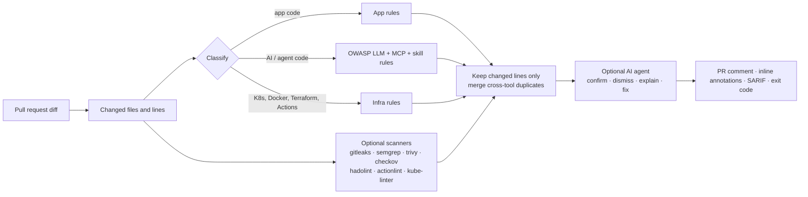

# agentic-code-review-tool

**Agentic, scanner-grounded code review for the whole pull request** — application code, infrastructure, and the AI/LLM/agent code most review tools don't understand yet.

`acr` reviews only the lines a PR changes, runs high-precision built-in rules plus the open-source scanners you already trust, merges duplicates, and (optionally) hands every finding to an LLM agent that reads the surrounding code to confirm it, dismiss false positives and write the fix. The output is one PR comment, inline annotations, SARIF for GitHub code scanning, and an exit code that can gate the merge.

```text
$ acr review --base origin/main
## Agentic code review · ❌ Changes requested
🔴 1 critical · 🟠 3 high · 🟡 2 medium · 🔵 1 low
| 🔴 | critical | `agent.py:12`            | LLM output used as code, shell, SQL or HTML (LLM05)  | ACR-AI-002   |
| 🟠 | high     | `.github/workflows/x.yml:9` | Untrusted event data interpolated into a shell script | ACR-GHA-002 |
| 🟠 | high     | `k8s/trainer.yaml:14`     | Dangerous Linux capability added                      | ACR-K8S-004  |
```

## Why another code reviewer?

- **The whole PR, not one language.** Real PRs change Python *and* the Dockerfile, the Helm chart and a workflow. One review covers all of it.
- **AI/agent code is a first-class target.** Rules mapped to the [OWASP Top 10 for LLM Applications](https://genai.owasp.org/llm-top-10/): prompt injection, LLM output reaching `exec`/SQL/HTML, `trust_remote_code`, unbounded token spend, provider keys in the browser — plus the new AI supply chain: unpinned **MCP servers**, tokens in MCP configs, and **agent skills** that pipe scripts into a shell, read credentials or hide instructions.
- **Grounded, not guessed.** Deterministic rules and real scanners decide *what* and *where*; the agent only verifies and explains. Every finding has an exact file and line.
- **Adoptable on legacy code.** Only changed lines are reviewed, so turning it on doesn't drown every PR in old debt.
- **Works without any LLM.** The deterministic layer is useful on its own; the agent is opt-in.

## How it works



## Quick start

```bash
pip install git+https://github.com/sunilmehta-si/agentic-code-review-tool
cd your-repo

acr review                         # working tree vs HEAD
acr review --base origin/main      # what a PR would change (merge-base)
acr review --all                   # audit every tracked file
acr review --format sarif -o acr.sarif   # for GitHub code scanning
acr rules                          # list built-in rules
```

| Option | Default | Meaning |
|---|---|---|
| `--fail-on {critical,high,medium,low,never}` | `high` | Exit 1 if a finding at or above this severity remains |
| `--no-scanners` | off | Built-in rules only |
| `--scanners semgrep,trivy` | all installed | Run a subset of external scanners |
| `--exclude 'docs/*'` | — | Skip paths (repeatable) |
| `--sarif`, `--json`, `--markdown PATH` | — | Write extra report formats from the same run (no re-scan) |
| `--baseline FILE` | `.acr-baseline.json` if present | Suppress findings accepted with `acr baseline` |

Suppress a deliberate, reviewed line with an inline `acr:ignore` comment.

## Configure once per repository

```yaml
# .acr.yml  (command-line flags win over this file)
fail_on: high
exclude: ["docs/*", "*.generated.go"]
disable: ["ACR-AI-007"]          # rule ids or globs, e.g. "hadolint:*"
severity:
  ACR-K8S-009: medium            # per-rule severity overrides
scanners: [semgrep, trivy]
ai: claude                       # none | claude | openai
```

Unknown or invalid settings stop the run with a clear error instead of being silently ignored.

**Adopting on an existing codebase:** run `acr baseline` once and commit `.acr-baseline.json`. Known findings are suppressed,
matched by rule and line *content* so they survive code moving around, and only new problems fail pull requests.


## Demo

[`examples/insecure-app`](examples/insecure-app) is a small project with deliberate mistakes in every area. Running

```bash
acr review --root examples/insecure-app --all --no-scanners --fail-on never
```

reports **51 findings across 11 files** (6 critical, 26 high, 16 medium, 3 low). One finding from each rule family:

| | Severity | Location | Issue | Rule |
|---|---|---|---|---|
| 🔴 | critical | `.github/workflows/triage.yml:12` | pull_request_target checks out untrusted PR code | `ACR-GHA-001` |
| 🔴 | critical | `.mcp.json:6` | Credential stored in plain text in an MCP config | `ACR-MCP-002` |
| 🔴 | critical | `agent.py:24` | LLM output used as code, shell, SQL or HTML (LLM05 Improper Output Handling) | `ACR-AI-002` |
| 🔴 | critical | `infra/main.tf:7` | Sensitive port open to the whole internet | `ACR-TF-001` |
| 🔴 | critical | `k8s/trainer.yaml:18` | Privileged container or privilege escalation allowed | `ACR-K8S-001` |
| 🔴 | critical | `skills/deploy-helper/SKILL.md:8` | Agent skill reads credentials or sends data out | `ACR-SKILL-002` |
| 🟠 | high | `.claude/settings.json:3` | Coding agent run with its permission checks or sandbox turned off (LLM06 Excessive Agency) | `ACR-AI-010` |
| 🟠 | high | `Dockerfile:2` | Secret baked into the image via ENV or ARG | `ACR-DOCKER-005` |
| 🟠 | high | `agent.py:24` | Dynamic code execution | `ACR-APP-003` |
| 🟠 | high | `app.py:6` | Hardcoded password or token | `ACR-SEC-002` |

The full run is checked in CI by `tests/test_examples.py`, so a rule that stops firing fails the build.

### In a container

```bash
docker build -t acr .
docker run --rm -v "$PWD:/src" acr review --base origin/main
```

The image runs as a non-root user and pins its base image by digest.

### As a pre-commit hook

```yaml
# .pre-commit-config.yaml
repos:
  - repo: https://github.com/sunilmehta-si/agentic-code-review-tool
    rev: v0.2.0
    hooks:
      - id: acr
```

The hook runs the built-in rules only (fast, offline) with `--staged`, so it reviews exactly what is being committed and
ignores unstaged edits. CI can run the full review with scanners and the AI agent.

## Use it in GitHub Actions

```yaml
# .github/workflows/code-review.yml
name: code-review
on: pull_request
permissions:
  contents: read
  pull-requests: write     # inline review comments
  security-events: write   # SARIF upload to code scanning
jobs:
  review:
    runs-on: ubuntu-latest
    steps:
      - uses: actions/checkout@3d3c42e5aac5ba805825da76410c181273ba90b1 # v7.0.1
        with:
          fetch-depth: 0
          persist-credentials: false
      - uses: sunilmehta-si/agentic-code-review-tool@main   # pin to a release SHA once tagged
        with:
          fail-on: high
          ai: claude                                        # or: none, openai
          anthropic-api-key: ${{ secrets.ANTHROPIC_API_KEY }}
      - uses: github/codeql-action/upload-sarif@24c54180a607b1449ed407dd24f251e4e9147c8d # v4.38.3
        if: always()
        with:
          sarif_file: acr.sarif
```

The action writes the summary to the job page, posts inline comments on the PR, uploads SARIF to the Security tab, and fails the check only after all of that is published.

## AI review

With `--ai`, an LLM agent verifies every deterministic finding before you see it. It reads the surrounding code with three **read-only, repository-confined tools** (`read_file`, `search_repo`, `list_changed_files`), then marks each finding *confirmed*, *false positive* or *uncertain*, explains it in plain language and writes a concrete fix. It may add up to five issues of its own, but only on lines the PR changes.

```bash
pip install "agentic-code-review-tool[claude] @ git+https://github.com/sunilmehta-si/agentic-code-review-tool"
export ANTHROPIC_API_KEY=...            # or: ant auth login
acr review --base origin/main --ai claude

# Any OpenAI-compatible endpoint: OpenAI, vLLM, Ollama, LM Studio, LiteLLM
export ACR_OPENAI_BASE_URL=http://localhost:11434/v1 ACR_MODEL=qwen2.5-coder:32b
acr review --base origin/main --ai openai
```

| Setting | Default | Notes |
|---|---|---|
| `--ai claude` | model `claude-opus-5-5`, effort `high` | Official Anthropic SDK; cached system prompt; structured JSON verdicts; server-side fallback on safety refusals (`ACR_CLAUDE_FALLBACKS=0` to disable) |
| `--ai openai` | `ACR_MODEL` required | Standard-library HTTP only, so it works air-gapped with a local model |
| `--model`, `ACR_MODEL`, `ACR_EFFORT` | — | Override model and effort |
| `--max-steps` | 12 | Upper bound on agent tool calls |

**The agent is treated as untrusted too.** Repository content is passed as data, the prompt tells the model not to follow instructions found in code, the tools cannot write, execute or leave the repository, and new findings off the changed lines are discarded. If the AI step fails for any reason (no key, rate limit, refusal), the deterministic review is still published and the report says why.

## Built-in rules

68 rules, generated from the code (`acr rules`; `acr explain <id>` for details):

<!-- regenerate: acr rules --format markdown -->

| Area | Rule | Severity | What it catches |
|---|---|---|---|
| Secrets | `ACR-K8S-011` | high | Kubernetes Secret with real values committed to git |
| Secrets | `ACR-MCP-002` | critical | Credential stored in plain text in an MCP config |
| Secrets | `ACR-SEC-001` | critical | Provider credential committed to source |
| Secrets | `ACR-SEC-002` | high | Hardcoded password or token |
| Application code | `ACR-APP-001` | high | SQL built with string formatting |
| Application code | `ACR-APP-002` | high | Shell command built from a string |
| Application code | `ACR-APP-003` | high | Dynamic code execution |
| Application code | `ACR-APP-004` | high | Unsafe deserialisation |
| Application code | `ACR-APP-005` | medium | TLS certificate verification disabled |
| Application code | `ACR-APP-006` | medium | Debug mode enabled in application code |
| Application code | `ACR-APP-007` | low | Weak hash used for security |
| Application code | `ACR-APP-008` | critical | JWT accepted without verifying its signature or expiry |
| Application code | `ACR-APP-009` | high | CORS allows any origin together with credentials |
| Application code | `ACR-APP-010` | medium | Predictable random numbers used for a secret value |
| Application code | `ACR-APP-011` | high | XML parser resolves external entities (XXE) |
| AI / LLM / agent code | `ACR-AI-001` | high | User input concatenated into a system prompt (LLM01 Prompt Injection) |
| AI / LLM / agent code | `ACR-AI-002` | critical | LLM output used as code, shell, SQL or HTML (LLM05 Improper Output Handling) |
| AI / LLM / agent code | `ACR-AI-003` | high | Agent given dangerous tools without guardrails (LLM06 Excessive Agency) |
| AI / LLM / agent code | `ACR-AI-004` | high | Untrusted model code or weights loaded (LLM03 Supply Chain) |
| AI / LLM / agent code | `ACR-AI-005` | medium | LLM call without an output-token limit (LLM10 Unbounded Consumption) |
| AI / LLM / agent code | `ACR-AI-006` | critical | Provider API key exposed to the browser (LLM02 Sensitive Information Disclosure) |
| AI / LLM / agent code | `ACR-AI-007` | low | Full prompts or model responses written to logs (LLM02 Sensitive Information Disclosure) |
| AI / LLM / agent code | `ACR-AI-008` | high | Secret or credential placed in a system prompt (LLM07 System Prompt Leakage) |
| AI / LLM / agent code | `ACR-AI-009` | medium | Agent loop has no step or iteration limit (LLM10 Unbounded Consumption) |
| AI / LLM / agent code | `ACR-AI-010` | high | Coding agent run with its permission checks or sandbox turned off (LLM06 Excessive Agency) |
| AI / LLM / agent code | `ACR-AI-011` | high | Agent settings pre-approve any shell command or risky ones (LLM06 Excessive Agency) |
| AI / LLM / agent code | `ACR-MCP-001` | high | MCP server installed from an unpinned package |
| AI / LLM / agent code | `ACR-MCP-003` | high | MCP server over plain HTTP or with broad host access |
| AI / LLM / agent code | `ACR-MCP-004` | medium | MCP tools run without asking the user |
| AI / LLM / agent code | `ACR-SKILL-001` | high | Agent skill tells the agent to run a remote script |
| AI / LLM / agent code | `ACR-SKILL-002` | critical | Agent skill reads credentials or sends data out |
| AI / LLM / agent code | `ACR-SKILL-003` | high | Agent skill contains hidden or override instructions |
| Kubernetes | `ACR-K8S-001` | critical | Privileged container or privilege escalation allowed |
| Kubernetes | `ACR-K8S-002` | high | Pod shares the host's network, PID or IPC namespace |
| Kubernetes | `ACR-K8S-003` | high | hostPath volume mounts the node's filesystem |
| Kubernetes | `ACR-K8S-004` | high | Dangerous Linux capability added |
| Kubernetes | `ACR-K8S-005` | medium | Container image not pinned (latest or no tag) |
| Kubernetes | `ACR-K8S-006` | high | Container runs as root (UID 0) |
| Kubernetes | `ACR-K8S-007` | medium | Container has no CPU/memory limits |
| Kubernetes | `ACR-K8S-008` | medium | GPU requested without a matching limit |
| Kubernetes | `ACR-K8S-009` | low | Pod does not require a non-root user |
| Kubernetes | `ACR-K8S-010` | high | RBAC grants wildcard permissions or cluster-admin |
| Kubernetes | `ACR-K8S-012` | high | Seccomp or AppArmor confinement turned off |
| Dockerfile | `ACR-DOCKER-001` | medium | Base image not pinned (latest or no tag) |
| Dockerfile | `ACR-DOCKER-002` | medium | Image runs as root (no USER instruction) |
| Dockerfile | `ACR-DOCKER-003` | high | Remote script piped straight into a shell |
| Dockerfile | `ACR-DOCKER-004` | low | ADD fetches a remote URL |
| Dockerfile | `ACR-DOCKER-005` | high | Secret baked into the image via ENV or ARG |
| Dockerfile | `ACR-DOCKER-006` | low | Package manager cache or sudo left in the image |
| Dockerfile | `ACR-DOCKER-007` | medium | World-writable permissions set in the image |
| Dockerfile | `ACR-DOCKER-008` | high | TLS or package signature checks disabled during the build |
| GitHub Actions | `ACR-GHA-001` | critical | pull_request_target checks out untrusted PR code |
| GitHub Actions | `ACR-GHA-002` | high | Untrusted event data interpolated into a shell script |
| GitHub Actions | `ACR-GHA-003` | medium | Third-party action not pinned to a commit SHA |
| GitHub Actions | `ACR-GHA-004` | medium | Workflow token has broad or default permissions |
| GitHub Actions | `ACR-GHA-005` | high | Secret printed to the workflow log |
| GitHub Actions | `ACR-GHA-006` | low | Deprecated workflow command |
| GitHub Actions | `ACR-GHA-007` | medium | Cloud OIDC token granted to every job in the workflow |
| GitHub Actions | `ACR-GHA-008` | medium | Every repository secret handed to an external reusable workflow |
| GitHub Actions | `ACR-GHA-009` | medium | Self-hosted runner used by a pull-request workflow |
| Terraform | `ACR-TF-001` | critical | Sensitive port open to the whole internet |
| Terraform | `ACR-TF-002` | high | Storage or data service exposed publicly |
| Terraform | `ACR-TF-003` | high | Encryption or TLS weakened |
| Terraform | `ACR-TF-004` | high | Wildcard or owner-level IAM permission |
| Terraform | `ACR-TF-005` | medium | Kubernetes control plane reachable from the internet or legacy auth on |
| Terraform | `ACR-TF-006` | low | Module source not pinned to a version |
| Terraform | `ACR-TF-007` | medium | Database can be destroyed without protection or a final backup |
| Terraform | `ACR-TF-008` | medium | Instance metadata reachable without session tokens (credential theft via SSRF) |

## Optional scanners

Installed scanners run automatically on the file types they understand; missing ones are skipped and listed in the report.

| Scanner | Covers |
|---|---|
| [Gitleaks](https://github.com/gitleaks/gitleaks) | Secrets in any file |
| [Semgrep](https://github.com/semgrep/semgrep) | SAST for application code (`ACR_SEMGREP_CONFIG`, default `p/default`) |
| [Trivy](https://github.com/aquasecurity/trivy) | Vulnerable dependencies and IaC misconfiguration |
| [Checkov](https://github.com/bridgecrewio/checkov) | Terraform, Kubernetes, Dockerfile, GitHub Actions |
| [hadolint](https://github.com/hadolint/hadolint) | Dockerfiles |
| [actionlint](https://github.com/rhysd/actionlint) | GitHub Actions workflows |
| [kube-linter](https://github.com/stackrox/kube-linter) | Kubernetes manifests |

When two tools report the same issue on the same line, the report shows it once and credits both.

## Status

| Part | State |
|---|---|
| Diff-aware engine, 58 built-in rules, 7 scanner adapters (run in parallel) | ✅ Done, unit-tested |
| Markdown / JSON / SARIF reports, CLI with severity gate | ✅ Done, unit-tested |
| AI review agent (Claude + OpenAI-compatible) with read-only tools | ✅ Done, unit-tested with a fake model |
| Inline PR comments and composite GitHub Action (single run) | ✅ Done, unit-tested; first live run pending |
| `.acr.yml` config, baseline, `acr explain`, pre-commit hook, container image | ✅ Done (v0.2.0) |

## Design notes

Inspired by the hybrid "deterministic pipeline + agent" approach popularised by [Open Code Review](https://github.com/alibaba/open-code-review); this project is an independent implementation focused on security, infrastructure and AI/agent code, with no code shared.

## License

[MIT](LICENSE) © Sunil Mehta
