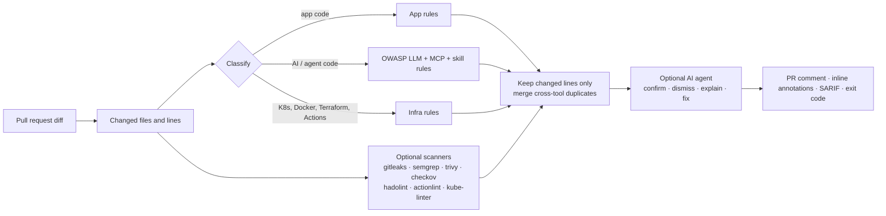

# agentic-code-review-tool

**Agentic, scanner-grounded code review for the whole pull request** — application code, infrastructure, and the AI/LLM/agent code most review tools don't understand yet.

`acr` reviews only the lines a PR changes, runs high-precision built-in rules plus the open-source scanners you already trust, merges duplicates, and (optionally) hands every finding to an LLM agent that reads the surrounding code to confirm it, dismiss false positives and write the fix. The output is one PR comment, inline annotations, SARIF for GitHub code scanning, and an exit code that can gate the merge.

```text
$ acr review --base origin/main
## Agentic code review · ❌ Changes requested
🔴 1 critical · 🟠 3 high · 🟡 2 medium · 🔵 1 low
| 🔴 | critical | `agent.py:12`            | LLM output used as code, shell, SQL or HTML (LLM05)  | ACR-AI-002   |
| 🟠 | high     | `.github/workflows/x.yml:9` | Untrusted event data interpolated into a shell script | ACR-GHA-002 |
| 🟠 | high     | `k8s/trainer.yaml:14`     | Dangerous Linux capability added                      | ACR-K8S-004  |
```

## Why another code reviewer?

- **The whole PR, not one language.** Real PRs change Python *and* the Dockerfile, the Helm chart and a workflow. One review covers all of it.
- **AI/agent code is a first-class target.** Rules mapped to the [OWASP Top 10 for LLM Applications](https://genai.owasp.org/llm-top-10/): prompt injection, LLM output reaching `exec`/SQL/HTML, `trust_remote_code`, unbounded token spend, provider keys in the browser — plus the new AI supply chain: unpinned **MCP servers**, tokens in MCP configs, and **agent skills** that pipe scripts into a shell, read credentials or hide instructions.
- **Grounded, not guessed.** Deterministic rules and real scanners decide *what* and *where*; the agent only verifies and explains. Every finding has an exact file and line.
- **Adoptable on legacy code.** Only changed lines are reviewed, so turning it on doesn't drown every PR in old debt.
- **Works without any LLM.** The deterministic layer is useful on its own; the agent is opt-in.

## How it works



## Quick start

```bash
pip install git+https://github.com/sunilmehta-si/agentic-code-review-tool
cd your-repo

acr review                         # working tree vs HEAD
acr review --base origin/main      # what a PR would change (merge-base)
acr review --all                   # audit every tracked file
acr review --format sarif -o acr.sarif   # for GitHub code scanning
acr rules                          # list built-in rules
```

| Option | Default | Meaning |
|---|---|---|
| `--fail-on {critical,high,medium,low,never}` | `high` | Exit 1 if a finding at or above this severity remains |
| `--no-scanners` | off | Built-in rules only |
| `--scanners semgrep,trivy` | all installed | Run a subset of external scanners |
| `--exclude 'docs/*'` | — | Skip paths (repeatable) |

Suppress a deliberate, reviewed line with an inline `acr:ignore` comment.

## Built-in rules

48 rules, generated from the code (`acr rules`):

| Area | Rule | Severity | What it catches |
|---|---|---|---|
| Secrets | `ACR-MCP-002` | critical | Credential stored in plain text in an MCP config |
| Secrets | `ACR-SEC-001` | critical | Provider credential committed to source |
| Secrets | `ACR-SEC-002` | high | Hardcoded password or token |
| Application code | `ACR-APP-001` | high | SQL built with string formatting |
| Application code | `ACR-APP-002` | high | Shell command built from a string |
| Application code | `ACR-APP-003` | high | Dynamic code execution |
| Application code | `ACR-APP-004` | high | Unsafe deserialisation |
| Application code | `ACR-APP-005` | medium | TLS certificate verification disabled |
| Application code | `ACR-APP-006` | medium | Debug mode enabled in application code |
| Application code | `ACR-APP-007` | low | Weak hash used for security |
| AI / LLM / agent code | `ACR-AI-001` | high | User input concatenated into a system prompt (LLM01 Prompt Injection) |
| AI / LLM / agent code | `ACR-AI-002` | critical | LLM output used as code, shell, SQL or HTML (LLM05 Improper Output Handling) |
| AI / LLM / agent code | `ACR-AI-003` | high | Agent given dangerous tools without guardrails (LLM06 Excessive Agency) |
| AI / LLM / agent code | `ACR-AI-004` | high | Untrusted model code or weights loaded (LLM03 Supply Chain) |
| AI / LLM / agent code | `ACR-AI-005` | medium | LLM call without an output-token limit (LLM10 Unbounded Consumption) |
| AI / LLM / agent code | `ACR-AI-006` | critical | Provider API key exposed to the browser (LLM02 Sensitive Information Disclosure) |
| AI / LLM / agent code | `ACR-AI-007` | low | Full prompts or model responses written to logs (LLM02 Sensitive Information Disclosure) |
| AI / LLM / agent code | `ACR-MCP-001` | high | MCP server installed from an unpinned package |
| AI / LLM / agent code | `ACR-MCP-003` | high | MCP server over plain HTTP or with broad host access |
| AI / LLM / agent code | `ACR-SKILL-001` | high | Agent skill tells the agent to run a remote script |
| AI / LLM / agent code | `ACR-SKILL-002` | critical | Agent skill reads credentials or sends data out |
| AI / LLM / agent code | `ACR-SKILL-003` | high | Agent skill contains hidden or override instructions |
| Kubernetes | `ACR-K8S-001` | critical | Privileged container or privilege escalation allowed |
| Kubernetes | `ACR-K8S-002` | high | Pod shares the host's network, PID or IPC namespace |
| Kubernetes | `ACR-K8S-003` | high | hostPath volume mounts the node's filesystem |
| Kubernetes | `ACR-K8S-004` | high | Dangerous Linux capability added |
| Kubernetes | `ACR-K8S-005` | medium | Container image not pinned (latest or no tag) |
| Kubernetes | `ACR-K8S-006` | high | Container runs as root (UID 0) |
| Kubernetes | `ACR-K8S-007` | medium | Container has no CPU/memory limits |
| Kubernetes | `ACR-K8S-008` | medium | GPU requested without a matching limit |
| Kubernetes | `ACR-K8S-009` | low | Pod does not require a non-root user |
| Dockerfile | `ACR-DOCKER-001` | medium | Base image not pinned (latest or no tag) |
| Dockerfile | `ACR-DOCKER-002` | medium | Image runs as root (no USER instruction) |
| Dockerfile | `ACR-DOCKER-003` | high | Remote script piped straight into a shell |
| Dockerfile | `ACR-DOCKER-004` | low | ADD fetches a remote URL |
| Dockerfile | `ACR-DOCKER-005` | high | Secret baked into the image via ENV or ARG |
| Dockerfile | `ACR-DOCKER-006` | low | Package manager cache or sudo left in the image |
| GitHub Actions | `ACR-GHA-001` | critical | pull_request_target checks out untrusted PR code |
| GitHub Actions | `ACR-GHA-002` | high | Untrusted event data interpolated into a shell script |
| GitHub Actions | `ACR-GHA-003` | medium | Third-party action not pinned to a commit SHA |
| GitHub Actions | `ACR-GHA-004` | medium | Workflow token has broad or default permissions |
| GitHub Actions | `ACR-GHA-005` | high | Secret printed to the workflow log |
| GitHub Actions | `ACR-GHA-006` | low | Deprecated workflow command |
| Terraform | `ACR-TF-001` | critical | Sensitive port open to the whole internet |
| Terraform | `ACR-TF-002` | high | Storage or data service exposed publicly |
| Terraform | `ACR-TF-003` | high | Encryption or TLS weakened |
| Terraform | `ACR-TF-004` | high | Wildcard or owner-level IAM permission |
| Terraform | `ACR-TF-005` | medium | Kubernetes control plane reachable from the internet or legacy auth on |
| Terraform | `ACR-TF-006` | low | Module source not pinned to a version |

## Optional scanners

Installed scanners run automatically on the file types they understand; missing ones are skipped and listed in the report.

| Scanner | Covers |
|---|---|
| [Gitleaks](https://github.com/gitleaks/gitleaks) | Secrets in any file |
| [Semgrep](https://github.com/semgrep/semgrep) | SAST for application code (`ACR_SEMGREP_CONFIG`, default `p/default`) |
| [Trivy](https://github.com/aquasecurity/trivy) | Vulnerable dependencies and IaC misconfiguration |
| [Checkov](https://github.com/bridgecrewio/checkov) | Terraform, Kubernetes, Dockerfile, GitHub Actions |
| [hadolint](https://github.com/hadolint/hadolint) | Dockerfiles |
| [actionlint](https://github.com/rhysd/actionlint) | GitHub Actions workflows |
| [kube-linter](https://github.com/stackrox/kube-linter) | Kubernetes manifests |

When two tools report the same issue on the same line, the report shows it once and credits both.

## Status

| Part | State |
|---|---|
| Diff-aware engine, 49 built-in rules, 7 scanner adapters | ✅ Done, unit-tested |
| Markdown / JSON / SARIF reports, CLI with severity gate | ✅ Done, unit-tested |
| AI review agent (Claude + OpenAI-compatible) | 🚧 In progress |
| Inline PR comments and GitHub Action | 🚧 In progress |

## Design notes

Inspired by the hybrid "deterministic pipeline + agent" approach popularised by [Open Code Review](https://github.com/alibaba/open-code-review); this project is an independent implementation focused on security, infrastructure and AI/agent code, with no code shared.

## License

[MIT](LICENSE) © Sunil Mehta
