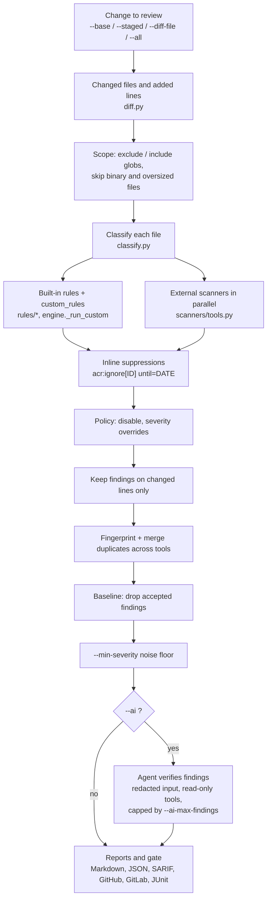

# Architecture

`acr` is a deterministic review pipeline with an optional AI step at the end. Everything before the AI step is
reproducible: the same commit, config and scanner versions always give the same findings on the same lines.

## Pipeline

The order matters:

- **Suppression runs before the policy filters**, at the finding's reported line. That way a structural rule (one that
  points at a container or a server entry) honours `acr:ignore` the same way a single-line rule does.
- **The changed-line filter runs after the rules.** Rules see the whole file, because many problems are only visible
  in context, but they only report lines the change touches. That is what lets the tool run on legacy code.
- **The noise floor runs before the AI step**, so no tokens are spent on findings nobody will see.
- **The gate is computed from the same result as every report.** The exit code, the PR comment, SARIF and JUnit can
  never disagree.

## Modules

| Module | Responsibility |
|---|---|
| `diff.py` | Turns git output or a patch into added line numbers per file; handles quoted paths and shallow clones |
| `classify.py` | Decides a file's kinds (`app`, `ai-code`, `kubernetes`, `compose`, `agent-settings`, ...) |
| `rules/` | One module per area; each rule is a function registered with `@rule`, plus its fix text and references |
| `scanners/tools.py` | Adapters that run gitleaks, semgrep, trivy, checkov, hadolint, actionlint and kube-linter and normalise their output |
| `engine.py` | Runs the pipeline above and returns a `ReviewResult` |
| `config.py` | Loads and validates `.acr.yml`, including custom rules |
| `baseline.py` | Fingerprints, writes, checks and prunes accepted findings |
| `agent/` | The optional AI reviewer: prompt and schema, redaction, sandboxed tools, Claude and OpenAI-compatible clients |
| `report.py` | Renders a `ReviewResult` into each output format |
| `github.py` | Posts the PR review and inline comments, with retries and duplicate suppression |
| `cli.py` | Argument parsing and the order in which the steps above are applied |

## Design rules

1. **Exact lines or nothing.** Every finding carries a file and line, so it can be placed on a diff, suppressed, baselined
   and fingerprinted.
2. **Precision over recall.** A built-in rule should almost always be right. Broad coverage comes from the external
   scanners.
3. **Untrusted input everywhere.** Code under review may contain text aimed at the AI agent. The agent gets
   redacted input and read-only tools that cannot leave the repository, and it may only add findings on changed lines.
4. **Fail loudly, degrade gracefully.** Invalid config stops the run with a clear message. A failed scanner or AI step
   is reported, and the rest of the review is still published.
5. **Fingerprints are content-based** (rule, path, normalised line text). Findings stay matched when code moves, and
   reappear when the flagged line changes.
